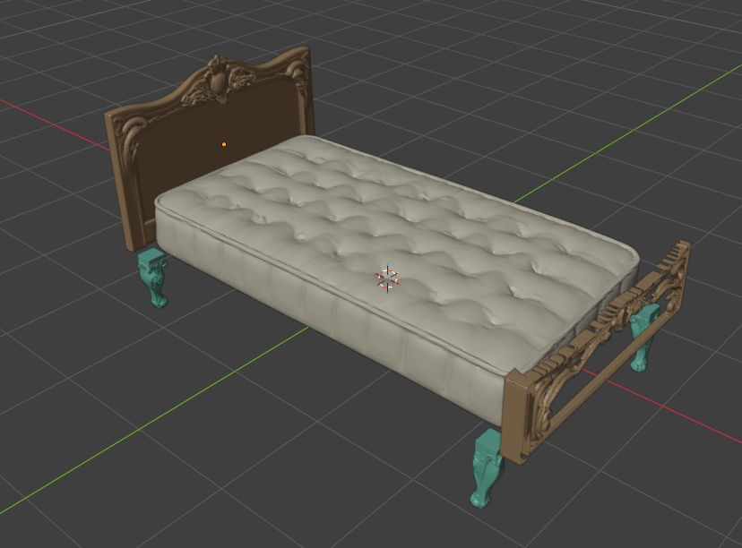

# Semantic Graybox

> **Structure = Human Guidance. Form = Generative Freedom.**

Human-guided structural control for generative 3D asset workflows.

**Status:** research prototype, v0.3.1 baseline.

## Research milestone — individual parts assembled in Blender

**Four generated part roles. Seven source-guided placements. One shared Leg mesh.**  
A staged workflow using the artist's real `Bed.blend` guides produced a Headboard, Footboard, Mattress and Leg master, then assembled them in Blender.

[](docs/reviews/2026-10-16-imagegen-triposg-workflow/README.md)

**Workflow:** real graybox guides → built-in ImageGen references → artist image approval → local TripoSG → raw-part inspection → uniform fitting and linked placement.

| Milestone | Recorded result |
|---|---|
| Individually generated roles | **4 / 4** |
| Generated placements in the original layout | **7 / 7**, including four linked Legs |
| Artist-approved raw shapes | **2 / 4** — Leg and Mattress |
| Program integration checks | **101 unit tests passed**; Blender 5.2.2 background smoke passed |

**Quality review remains open.** The Footboard lacks its solid centre, the Headboard retains detached ornament, and Mattress/Leg support contact is unresolved. Seven populated slots do not establish a finished, artist-approved bed. These are prototype results; the new integrated panel's manual check and live GPT Image API validation remain pending.

**[View the workflow, 14 evidence images and measured results →](docs/reviews/2026-10-16-imagegen-triposg-workflow/README.md)**

## Research reports

- **[2026-10-16 ImageGen + Local TripoSG Workflow and Bed Results](docs/reviews/2026-10-16-imagegen-triposg-workflow/README.md)** — executed workflow, exact conditioning, fourteen evidence figures, including four artist-supplied Blender screenshots, seven placements, remaining shape/contact failures, program-integration checks and the GPT Image API direction
- **[2026-10-15 Artist Assembly Review](docs/reviews/2026-10-15-rococo-bed/ARTIST_REVIEW.md)** — correct placement/scale still leaves wrong part semantics in the shown rococo Bed assembly; includes artist-supplied screenshots
- **[Korean Research Report (국문)](docs/RESEARCH_PAPER_KO.md)** — design, experiments, limitations, and future work
- **[English Research Report](docs/RESEARCH_PAPER_EN.md)** — English translation of the preliminary technical report

Both documents are **independent, preliminary technical reports (not peer-reviewed)**. Experimental logs and some third-party or private assets are not included in this public repository; the reports distinguish measured results from proposed future integrations.

Semantic Graybox lets an artist author a low-cost Blender graybox that carries structural intent—semantic part roles, anchors, orientation, relative proportions, repeated-part relationships, and placement slots. The system turns that structure into generator-neutral `GenerationRequest` units, sends them through an external generator adapter, then places generated geometry back into Blender for human review.

## Pipeline

```text
Blender Graybox
      ↓
Semantic Blueprint
      ↓
GenerationRequest[]
      ↓
Generator Adapter
      ↓
External 3D Generator
      ↓
Automatic Placement / Instancing
      ↓
Human Semantic Review
```

## Current scope

- Semantic Blueprint extraction
- Unique-part / repeated-master decomposition
- Sequential generation queue
- Linked instancing for repeated masters
- Blender placement and safe cleanup
- Human semantic review with append-only JSONL evidence
- External Cube3D adapter boundary

Cube3D source code and model weights are **not included** and are **not covered by this repository's MIT License**.

## Current limitations

This is not production-ready.

- Semantic mapping is still partly name-based.
- Parent/entity context needs stronger handling for ambiguous names.
- Stock Cube3D v0.5 has not been shown to reliably generate isolated furniture parts for the current requests.
- Synthetic Blender fixtures under `tests/` are regression fixtures only, not semantic-quality benchmarks.
- User-authored `.blend` assets and generated meshes are intentionally excluded.

## License

Original Semantic Graybox source code in this repository is licensed under the MIT License. Third-party software, models, runtimes, and dependencies remain subject to their own licenses.


