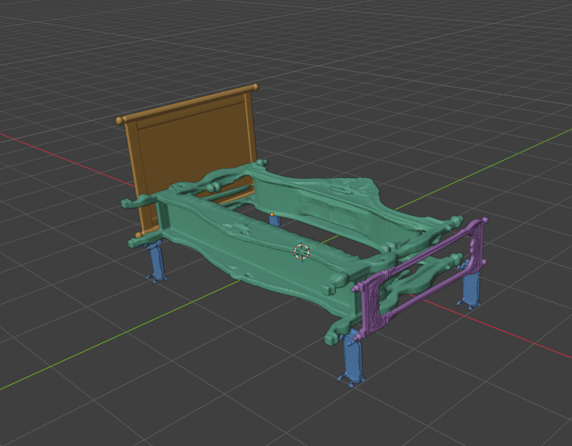
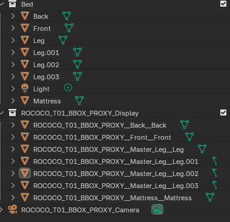
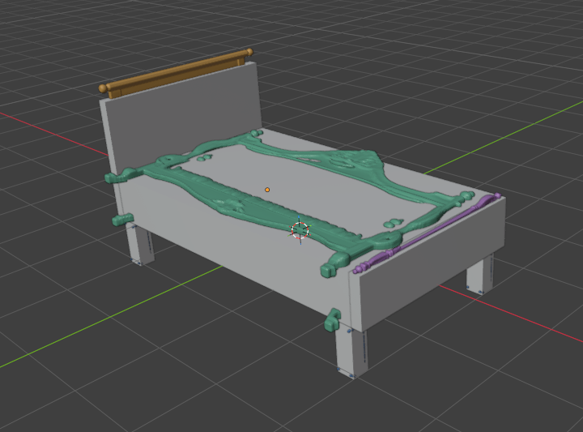

# Artist Review: Correct Placement Does Not Resolve Part Semantics

Date: 2026-10-15 (Asia/Seoul)  
Source: direct artist feedback and three artist-supplied Blender screenshots  
Scope: real `Bed.blend`, rococo, Trial 01, seed `20261001`, assembled `BBOX_PROXY` view

## Main finding

The artist reports that the generated outputs now occupy the intended positions and overall sizes in the shown assembly. **Except for the headboard, the outputs still look like scaled or deformed rococo desks/furniture rather than the requested isolated bed parts.**

This is evidence that placement and scale calibration can work while part semantics still fail. The current result does not establish a successful bed-part generation workflow.

The headboard is an exception in this qualitative feedback. It is **not automatically recorded as a formal ACCEPTED sample**, and this single assembly is not a verdict on all 40 baseline samples or both styles.

## Artist observation

English translation of the artist's feedback:

> The results are now placed at the correct positions and sizes, but except for the headplate, they are just rococo desks scaled and deformed to fit.

The observation is recorded as supplied. Shape names such as “desk-like” describe the artist's reading of the outputs; they are not an automated geometry classification.

## What each colour and source unit represents

| Source unit | Requested role | Display | Artist observation for this assembly |
|---|---|---|---|
| `Back` | Headboard | Orange | Named as the exception to the reported failure; no formal acceptance inferred |
| `Front` | Footboard | Purple | Included in the reported non-headboard failure: wrong furniture/part content remains |
| `Master_Leg` from `Leg`, `Leg.001`, `Leg.002`, `Leg.003` | One leg master, four linked placements | Blue | Included in the reported failure; correct leg-slot placement does not make the generated shape a valid leg |
| `Mattress` | Mattress | Green | Included in the reported failure; the output does not provide the intended mattress according to the artist |

The green geometry is the **actual cached Mattress-request output**, even where it resembles a furniture frame. It is not a newly modelled side-frame replacement.

When guides are visible, the grey slab and other grey blocks are the **original source guides**. The grey slab must not be counted as a successfully generated mattress.

## Exact conditioning inputs

The following are the **actual executed inputs for the displayed rococo Trial 01**, checked against the archived command arguments, stdout and frozen request snapshots. Role terms are ordinary text in the prompt; this stock path does not receive a separate part-role token or role embedding. `Back` and `Front` were already overridden to `headboard` and `footboard` before execution; the production `chair backrest` / `front` mappings were not the executed roles in this batch.

| Source unit | Effective role vocabulary | Exact final text prompt | CLI BBox ratio (X, Y, Z) | Normalized model BBox (X, Y, Z) |
|---|---|---|---|---|
| `Back` | `headboard` | `A rococo carved headboard for a bed` | `(1.000000, 17.082581, 11.133671)` | `(0.112688, 1.925000, 1.254630)` |
| `Front` | `footboard` | `A rococo carved footboard for a bed` | `(1.000000, 17.082581, 4.319587)` | `(0.112688, 1.925000, 0.486765)` |
| `Master_Leg` | `furniture leg` | `A rococo carved furniture leg for a bed` | `(1.052877, 1.000000, 2.809334)` | `(0.721448, 0.685216, 1.925000)` |
| `Mattress` | `mattress` | `A rococo carved mattress for a bed` | `(6.678850, 3.954680, 1.000000)` | `(1.925000, 1.139831, 0.288223)` |

Ratios use minimum dimension = 1. The CLI converts each vector `r` to `1.925 * r / max(r)` before the model uses it; normalized values above are rounded to six decimals. The model receives CLIP text conditioning plus one BBox size vector. It does **not** receive the guide mesh, a reference image, the complete bed layout, slot coordinates or functional attachment constraints. These BBox values are proportion hints, not clipping boundaries. Common settings here were stock Cube3D v0.5, seed `20261001`, requested/effective `top_p=0.9`, resolution base `8.0`, and fast inference disabled.

**Confirmed prompt-routing issue:** the rule-based prompt builder adds `carved` whenever style text is nonempty, including for `Mattress`. Thus the actual mattress request was `A rococo carved mattress for a bed`; it supplied a carving cue to an upholstered role. All four prompts also contain the parent phrase `for a bed`, and none explicitly says `single` or `isolated`. The runtime has no separate negative-prompt input for this batch.

These input facts expose confounds; they do not establish their causal contribution. Parent-context prompt bleeding, inappropriate carving/style conditioning and a whole-furniture model prior remain distinct hypotheses. The artist observation alone cannot rank them or establish that whole-object bias is intrinsic to the checkpoint.

## Screenshot evidence

### 1. Generated outputs without source guides

All requested units can be seen together. Their presence and placement are separate from whether they fulfil their requested roles.

### 2. Source hierarchy and generated display objects

The source contains `Mattress`, `Back`, `Front`, and four `Leg` objects, plus a non-mesh Light. The display collection contains the corresponding seven generated placements. There are **no authored side-frame guides** in this source contract.

### 3. Original source guides overlaid

This view distinguishes generated geometry from the original grey mattress/leg/board guides. It does not supply the missing semantic content of a generated part.

The PNGs are the artist's supplied images, copied without editing. Their hashes and the observation scope are recorded in [artist_observation.json](artist_observation.json).

## Missing parts: semantic absence versus missing files

The cached experiment has outputs for all four declared request units. This observation therefore concerns **incorrect or absent required part content inside existing outputs**, rather than a missing output file.

In particular:

- A furniture-like result in a leg slot is still a part-semantic failure.
- A frame-like Mattress-request result does not supply a mattress merely because its position and extent are suitable.
- The original grey Mattress guide is preserved reference geometry, not a generated result.
- Side frames were not declared in the actual source/request contract. Their absence is distinct from a requested unit that failed to produce an output.

## What the assembly experiment changed

The assembled comparison reuses the existing stock Cube3D outputs. The numerical proxy view applies **one uniform scale and a translation** using a role-specific reference length and bbox-face proxy. It does not edit mesh vertices, stretch separate axes, regenerate geometry, or replace bad parts with newly modelled assets.

The artist's “scaled/deformed” description concerns the resulting appearance. The unwanted whole-furniture-like content already exists in the cached generated meshes; this report does not claim that assembly calibration converted a correctly generated leg into a desk.

Greyboxes remain references for structural intent, form, scale, and placement. They are not hard containers, and ornamental protrusions are not by themselves a semantic failure.

### Numerical placement context for the shown assembly

The table separates source dimensions, raw generated OBJ extents and the later display transform. Values are `(X, Y, Z)` and rounded to six decimals; guide/placed values use Blender scene units, while raw OBJ extents use generator coordinates. Placed extents are **derived from the archived raw OBJ BBox multiplied by the saved uniform scale**, not evidence of semantic correctness.

| Source unit | Guide dimensions | Raw generated BBox dimensions | Reference axis / BBox face | Uniform scale | Derived placed BBox dimensions |
|---|---|---|---|---|---|
| `Back` | `(0.160401, 2.740063, 1.785852)` | `(0.094985, 1.904671, 1.402627)` | Y / bottom | 1.438602 | `(0.136645, 2.740063, 2.017822)` |
| `Front` | `(0.160401, 2.740063, 0.692866)` | `(0.065383, 1.902697, 0.546418)` | Y / bottom | 1.440094 | `(0.094158, 2.740063, 0.786893)` |
| `Master_Leg` | `(0.259671, 0.246630, 0.692866)` | `(0.743703, 0.815371, 1.903599)` | Z / top | 0.363977 | `(0.270691, 0.296776, 0.692866)` |
| `Mattress` | `(4.627548, 2.740063, 0.692866)` | `(1.901792, 1.325195, 0.334153)` | X / bottom | 2.433257 | `(4.627548, 3.224540, 0.813081)` |

For each unit, `scale = guide_extent[reference_axis] / generated_extent[reference_axis]`; translation then aligns the selected top/bottom BBox-face centres. The proxy applies no axis stretching or clipping. In particular, the leg output's Z extent is reduced from about `1.903599` to `0.692866` with scale `0.363977` and the same mesh is linked into four leg slots. This can place a semantically wrong furniture-like form at the correct reference height. Its other dimensions are not independently fitted. For the mattress, X length is the matching reference; correct X extent does not establish a padded slab, correct thickness or valid connections. Four distinct T01 OBJ hashes were rechecked, so the recurring desk-like appearance is not literal reuse of one identical OBJ across these four roles.

## Evidence boundaries and review status

The local controlled baseline contains two styles × four units × five seeds = **40 evaluation outputs**, plus two excluded reproducibility controls. That execution pool is not the scope of the artist's single displayed-assembly observation.

At the original assembly audit, the verified local record was:

| Check | Recorded result | What it establishes |
|---|---|---|
| Evaluation outputs | 40 DONE | Execution/file completion only |
| Cached assembly coverage | Ten style/seed combinations, four units and seven placements per view | Coverage and source-to-output identity |
| Comparison views | 20 scenes / 140 display placements | Raw and proxy placement of the same geometry |
| Reloaded numerical proxy checks | Passed | Declared reference-length and bbox-proxy alignment, not functional joint quality |
| Existing tests / new assembly boundary tests | 59 / 8 passed | Regression and numerical boundary behaviour |
| Structural audit | 20/20 passed | Artifact identity, hashes, sampling records, source preservation |
| Protected local files | 204 hashes unchanged | Source assets, production code/tests, and referenced baseline evidence preserved |
| Formal per-sample UI review log | 1/40 reviewed; LEG T01 REJECTED / WRONG_PART | Incomplete formal semantic review |

This report adds a **qualitative human observation**. It does not append or overwrite production `semantic_reviews.jsonl`, manufacture per-unit UI review events, or calculate a final 40-sample acceptance rate. The latest formal-review count should be re-read from the local append-only log before any later aggregation.

The orange headboard's reported exception is not converted into a universal headboard success claim. The rococo T01 finding is not generalized to modern outputs or other seeds without inspection.

## Research implication and next validation

**Assembly correction has not resolved part-semantic generation.** Further progress should be measured against whether a generator produces the requested isolated role and required structure.

1. Complete role-specific human review using the existing outputs and original individual review scenes.
2. Record wrong-part/whole-object content and missing required features separately from placement, scale, file coverage, and intentional guide protrusion. Keep upholstered mattress results separate from carved-leg/board results.
3. Before attributing failures to the model, predeclare prompt-only contrasts at fixed checkpoint, BBox, paired seeds and sampling settings: parent phrase `for a bed` present/absent crossed with `carved` present/absent, with `rococo` held fixed. This separates the parent-context and carving factors, including their interaction. These are proposed checks, not completed experiments.
4. With parent/carving settings fixed, separately compare role prompts with/without `rococo`, then explicit isolation wording; evaluate mattress material/slab cues separately from ornamental wood-part cues. Record style-routing failure and persistent whole-object content under neutral isolated-part prompts as different findings. A material-specific rewrite that changes several cues is a bundled remedy, not a single-factor causal test.
5. Compare a predeclared, limited model variant only after those prompt checks and supported-conditioning checks. Preserve exact prompt, BBox, paired seeds and review criteria for that model comparison; document prompt changes as separate factors.
6. Revisit functional anchors and artist-facing assembly after semantically suitable parts are available. Do not count a resized wrong part as a semantic fix.

No production code, source assets, semantic-role research, model/runtime configuration, or generation outputs were changed for this GitHub update. No additional inference or training was run.

## Provenance

- Local controlled baseline: `GCR_A0_REAL`, batch `fe600f84f10e428c925f3f1cd9743415`.
- Cached assembly experiment: `GCR_CACHED_ASSEMBLY_20261015_01`, completed local execution directory `execution_20261015_02`.
- Displayed scene identified from the supplied Outliner: `ROCOCO_T01_BBOX_PROXY`.
- Source roles retain the approved experiment-only `Back=headboard`, `Front=footboard` overrides.
- Public disclosure for this revision is limited to the exact four T01 prompts/role terms, BBox conditions, common sampling settings and summarized placement measurements above, together with the previously published qualitative observation and supplied screenshots. Original source assets, generated mesh files, credentials, local filesystem paths and full/private experiment logs remain outside this public report.

Documentation revision, 2026-10-15: actual conditioning and placement evidence added after review feedback. The retrieved public Markdown contained no U+200B; the revised text was checked for zero-width formatting characters. This revision ran no new generation and made no new human semantic-review decisions.

## Follow-up: image-conditioned workflow and assembly

The [2026-10-16 workflow and results report](../2026-10-16-imagegen-triposg-workflow/README.md) documents the later built-in ImageGen + local TripoSG experiment, exact reference prompts, actual mesh renders, seven-slot trial assembly, remaining geometry/contact defects and local program-integration checks. It also records the latest decision to defer local image models and use GPT Image API for the future image stage; live API validation remains pending. This follow-up does not change the stock Cube3D observation or its formal review scope above.

