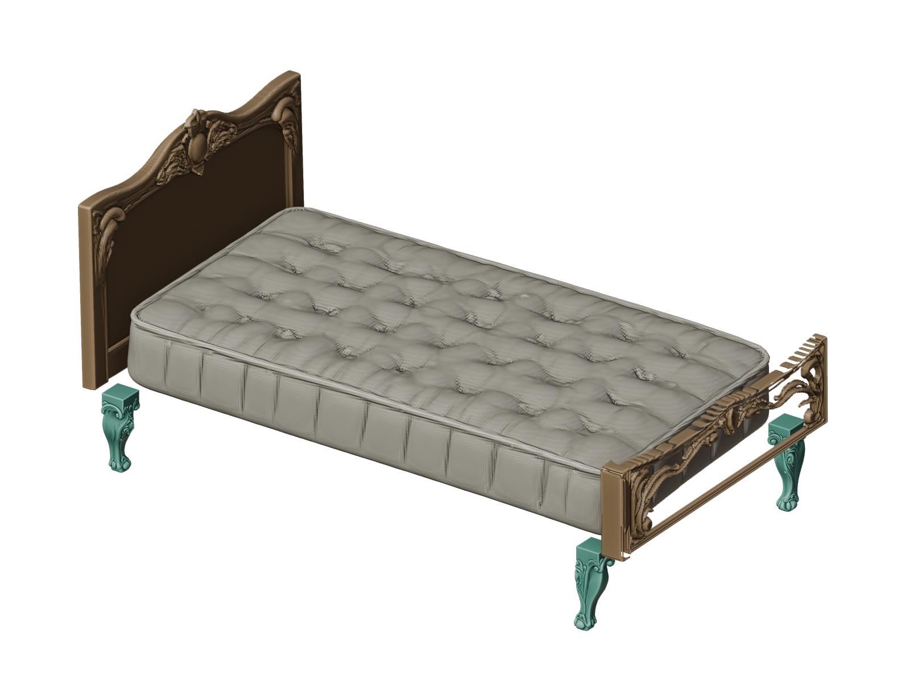
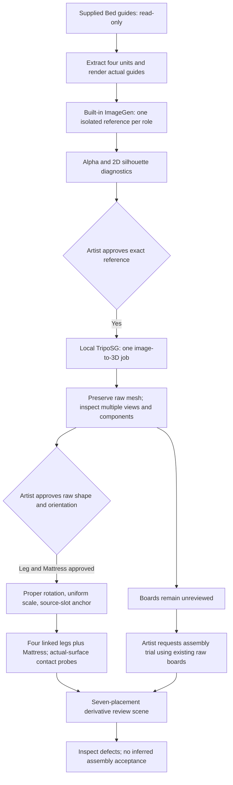
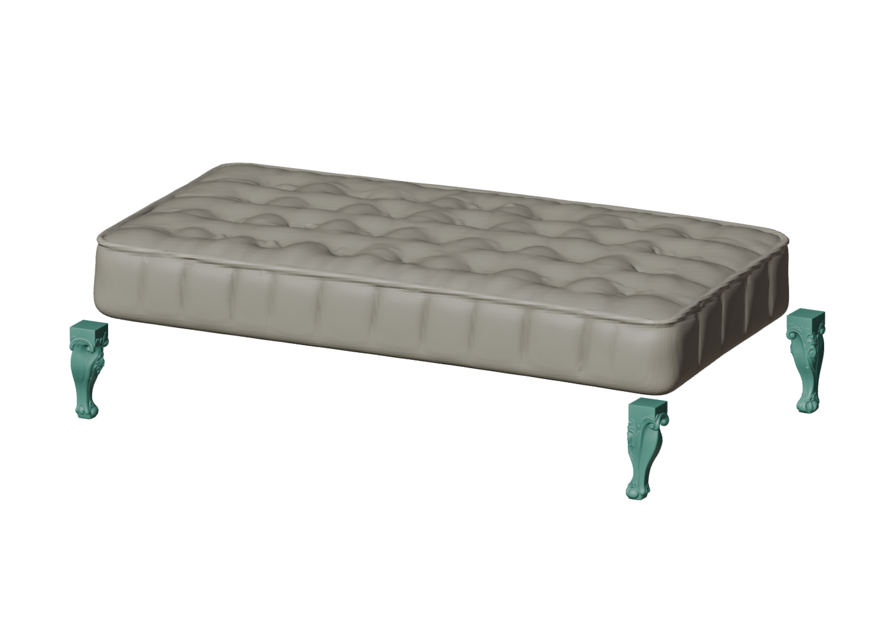
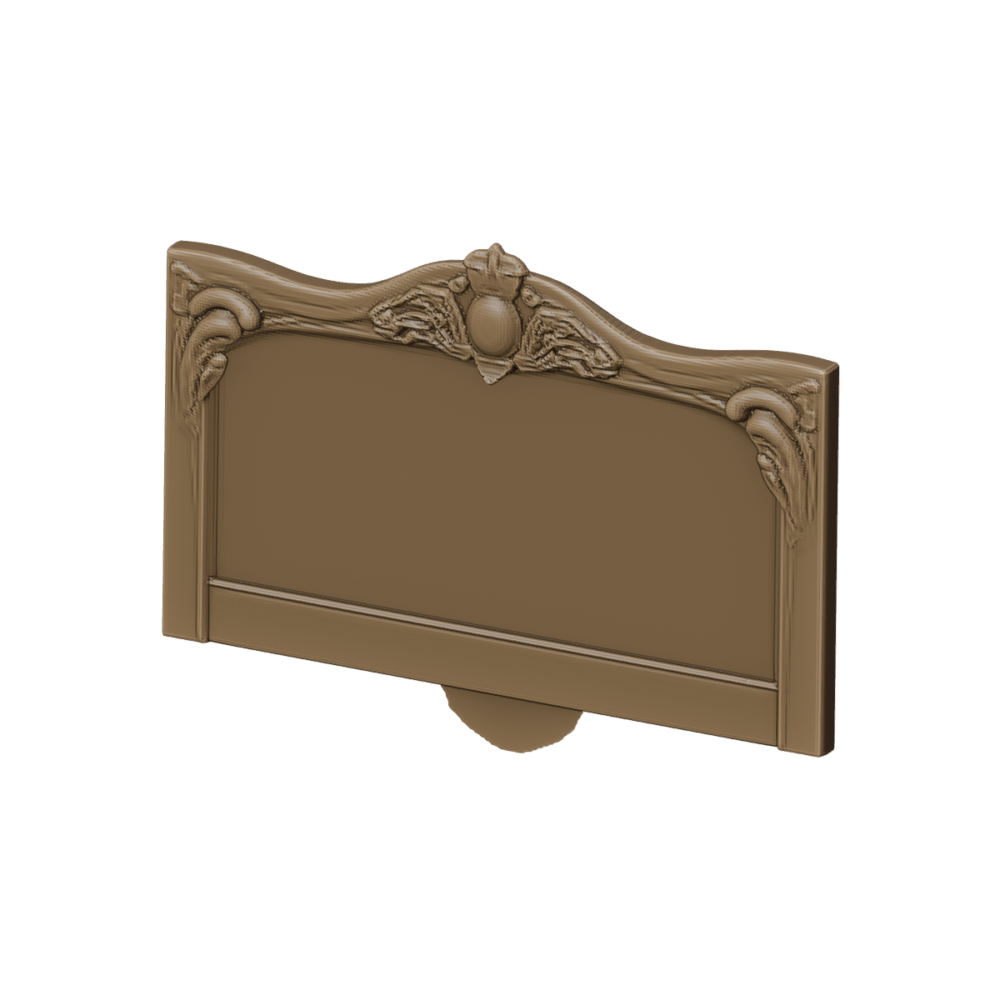
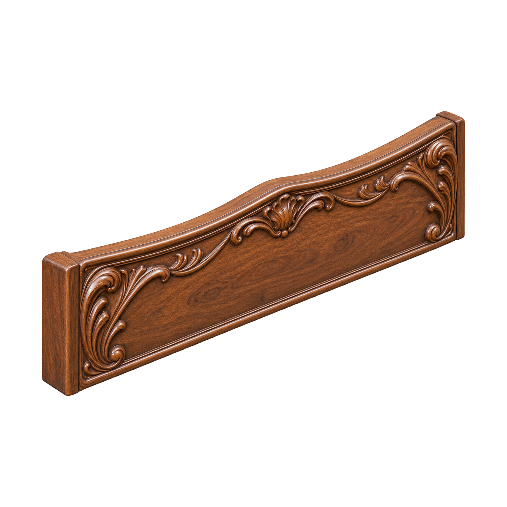
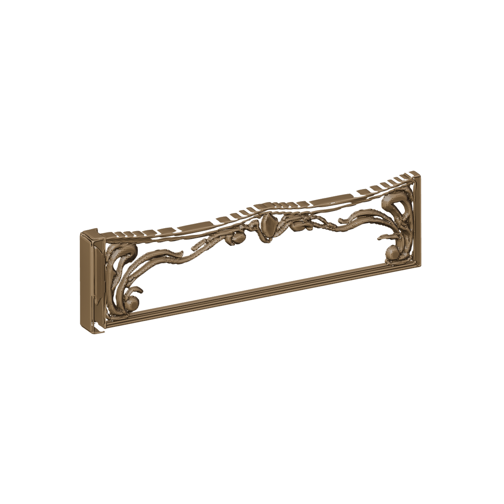

# From Graybox Guides to Isolated Parts: Workflow, Observations and Bed Assembly

Date: 2026-10-16, Asia/Seoul. Status: research prototype and partial quality validation.

**Four distinct part meshes were generated and placed into all seven declared Bed slots. This establishes execution and placement coverage, not a successfully completed bed.** The artist approved the Leg and Mattress raw shapes/orientations for placement testing. The boards remain unreviewed, the footboard lacks its solid centre, the headboard has detached geometry, and the Mattress/Leg contact diagnostic fails.

**Current direction:** defer local image-model adoption and use **GPT Image through the OpenAI API** for the future in-program image stage; retain the existing local TripoSG image-to-3D worker. The four references used for the assembly below were generated with the conversation's built-in ImageGen tool, not with that new API integration. Its underlying model version and seed were not exposed. The optional API implementation has only mocked-response tests; no live OpenAI Image API call or fully integrated API-to-assembly run is claimed.

This report follows the [stock Cube3D artist review](../2026-10-15-rococo-bed/ARTIST_REVIEW.md). It preserves that baseline as a separate experiment. It records what actually happened, including unsuccessful outputs and changes in scope.

This is a render of actual generated meshes, not a generated image of an imagined completed bed. One of the four legs is occluded from this view. [Reverse view](images/assembled-reverse.png). Brown, ivory and teal are inspection materials; no generated UV/PBR texture quality is demonstrated. The attractive overall silhouette does not resolve the defects below.

## 1. Asset contract and meaning of control

The supplied `Bed.blend` is the source of structural intent, proportions, coordinates and anchors. A graybox is **not a clipping cage**: ornament and a curved silhouette may extend beyond it. Correct coordinates, an exact reference-axis length, correct part identity and compatible mating surfaces are separate requirements.

| Source unit | Effective role | Guide dimensions X / Y / Z, scene units | Generated masters | Placement slots |
|---|---|---|---:|---:|
| `Back` | Headboard | 0.160401 / 2.740063 / 1.785852 | 1 | 1 |
| `Front` | Footboard | 0.160401 / 2.740063 / 0.692866 | 1 | 1 |
| `Master_Leg` from four `Leg*` guides | Support leg | 0.259671 / 0.246630 / 0.692866 | 1 | 4 |
| `Mattress` | Upholstered mattress | 4.627548 / 2.740063 / 0.692866 | 1 | 1 |

There are four generation units and seven mesh guides/slots, plus a non-mesh Light. There are no authored side-frame guides. A side frame was neither invented nor substituted for the Mattress. The raw production interpretation of `Back` remains `chair backrest`, and `Front` remains `front`; the experiment preserves those raw records and separately applies the approved Bed-specific headboard/footboard meanings.

Source assets were inspected without overwriting them. Review files are separate derivatives. The final assembly hides copied guides only in the review view layer; hidden guides are not counted as generated parts.

## 2. Routes tried and decisions made

| Route / stage | What was actually done | Observed response / result | Decision or limit |
|---|---|---|---|
| Stock Cube3D baseline | Controlled text + BBox trials, followed by cached assembly and artist review | In the shown rococo Trial 01, non-headboard parts read as whole rococo furniture/desks despite approximate size/location agreement | Placement calibration did not solve semantics. See the earlier report for exact prompts, BBoxes and review scope |
| Commercial Tripo API | One real text-to-3D Leg task, no user reference image; one mesh shared four times | A narrow single support leg, rather than a whole desk; insufficient evidence for the requested rich cabriole form. About 72.017 s adapter elapsed, 10 service credits; raw GLB 619,753 imported vertices / 1,213,956 faces | Human review remained unreviewed. This route was subsequently excluded by the artist; it is not the TripoSG route below |
| CubePart | Source/feasibility investigation of whole-mesh part decomposition | It would require a suitable whole object and a mapping study; no CubePart-generated bed is claimed | Artist chose to skip this route |
| Initial local TripoSG feasibility | A separate earlier two-role pilot: two built-in ImageGen references and two local mesh jobs | Leg and padded Mattress-like shapes exported, rendered and reloaded; that earlier leg was too slim relative to its guide | Technical feasibility only. These are different artifacts from the later four-role execution |
| Staged ImageGen + local TripoSG execution | Four new references, explicit image approvals, one mesh job per role, raw reviews and placement/contact tests | Distinct isolated part forms; all seven slots eventually populated; remaining structural and interface failures exposed | Current assembly reported here; no final quality pass |
| Local image-model investigation | Read-only source review, including MV-Adapter | A possible separate research direction, not an executed replacement for ImageGen | Local image generation is now deferred; no new image model was installed for this decision |
| GPT Image API integration | Optional provider/client implementation with mocked responses | Request/state/error and credential-redaction boundaries tested; no real API output or latency measured | Selected next image-provider direction, with live validation pending |

The stock baseline used CLIP text plus a BBox vector, not the actual graybox mesh. Its executed Mattress prompt was `A rococo carved mattress for a bed`, exposing an inappropriate carving cue for upholstery. Parent wording, style/material routing and the model's whole-object prior remain different hypotheses. Replacing both model and conditioning in the later workflow is a bundled remedy, not a controlled causal ablation.

Early deterministic Cube3D repeats under `top_p=None` are also a separate sampling issue. They should not be used to explain every semantically wrong shape. The earlier report already verified distinct OBJ hashes across the displayed four stock roles; desk-like similarity was not proof of literal identical-file reuse.

## 3. Workflow actually used for the current assembly

The reference stage used the **actual isolated guide render**, rather than an unrelated finished-furniture photograph. Prompts specified exactly one part, excluded whole beds/desks and unrelated parts, and separated decorative wood from upholstery. The Leg requested a substantial cabriole shaft, square upper mounting block and one foot, with a soft symmetry cue around the outward 45-degree corner bisector. The Mattress requested ivory woven textile, subtle quilting and a broad nearly flat underside, explicitly excluding carved wood. Boards used their own guide as geometry/pose input and the approved Leg image only for shared walnut/rococo style.

All four exact executed image prompts, input roles, guide/reference hashes and guide dimensions are in [conditioning_inputs.json](conditioning_inputs.json). These are the executed built-in ImageGen prompts, not a retrospective rewrite or proof of exact API reproducibility. The private guide raster files are identified by hash, not distributed here.

| Role | Approved built-in reference | Apparent 2D W/H difference from guide | Interpretation |
|---|---|---:|---|
| Leg | [Reference](images/leg-reference.png) | -14.3% | `NOT_COMPARABLE`: matching camera/projection unverified |
| Mattress | [Reference](images/mattress-reference.png) | +0.6% | Same qualification |
| Headboard | [Reference](images/headboard-reference.png) | +7.58% | Same qualification |
| Footboard | [Reference](images/footboard-reference.png) | +30.60% | Warning explicitly disclosed before human image approval |

The alpha-mask ratio is a warning signal. A requested camera match is not proof the generated view matches it. These percentages therefore do not certify a 2D proportion pass or predict exact 3D errors.

At the 3D stage, the approved RGBA image was cropped at alpha 128, composited onto white and square-padded by 10%. The worker called the image-conditioned pipeline with `image`, a seeded generator and frozen inference settings. **It did not send the legacy text prompt, role token, parent word, BBox, guide mesh or complete bed layout to the TripoSG model.** Guide dimensions were used for comparison and placement. This stock image path is distinct from the project's separate scribble/text model; see the [official TripoSG implementation](https://github.com/VAST-AI-Research/TripoSG).

## 4. Tools, runtime and boundaries

| Tool | Role in the work | Evidence / boundary |
|---|---|---|
| Semantic Graybox extractor, request and prompt modules | Read actual collection/mesh structure and preserve raw versus effective role records | Existing legacy `bpy.ops.semantic_graybox.generate()` / `run_generation()` paths remain available in the local integration |
| Blender 5.2.2 LTS, build `d13f752e3b9c` | Guide rendering, raw import, multiple views, shared instancing, review UI, placement, derivative saves and reload checks | Background automation and visible experiment-panel inspection were both used; new integrated panel manual check remains pending |
| Built-in ImageGen in the conversation | Four approved isolated RGBA references in the current staged execution | Online image tool; model ID/version and seed unavailable, no separate Image API request in this stage |
| Local TripoSG, isolated Python 3.10.11 runtime | Image-to-shape inference and raw export | Code `fc5c40990181e2a756c4e0b1c2f4d6b5202faf8c`; model revision `2c1c516d22d58db486a058d98d31bb6177344e06` |
| PyTorch / CUDA on RTX 5070 Ti | Local 3D computation | 16,303 MiB reported device memory; this does not establish local image-model capacity |
| Experiment JSON-lines worker, CPU image/mesh helpers, component analysis and ray probes | Serial dispatch, persistent audit records, image preparation and geometry diagnostics | Blender Python does not host the neural dependencies; raw geometry retained |
| Codex / Python automation and GitHub connector | Implement and test the workflow, inspect evidence and publish this report | Agent checks are not human semantic-review decisions |

Current four-role mesh settings: seed `20261015`, fp16, 50 denoising steps, CFG 7.0, 2,048 tokens, flash decoder disabled, dense octree depth 7 and hierarchical depth 8. Ten frozen model-file hashes were checked before dispatch. A disclosed experiment-runtime change lazily imports optional `diso` in its flash-only branch; it does not change weights or active hierarchical extraction computations. The original Cube3D runtime was preserved.

The worker stays warm for serial jobs. Back then Front used one model load. The implemented cancellation protocol drains an in-flight job, quarantines its cancelled result and keeps the worker reusable; it is not instantaneous GPU abortion. The new integration's warm reuse/cancellation checks used a fake worker, not a new live GPU cancellation experiment.

Raw export uses `trimesh.Trimesh(..., process=False)`. No clipping, nonuniform axis stretching, fragment deletion, remeshing or fabricated structural panel was used in the final assembly. PCA frames are orientation proposals, not automatic artist approvals. Fit uses one positive uniform scale plus proper rotation and translation.

## 5. Per-part results and artist decisions

| Current role | Raw vertices / faces | Components | Image approved | Raw shape / orientation | Final trial placements |
|---|---:|---:|---|---|---:|
| Leg | 84,737 / 169,486 | 2 | Yes | Artist approved for four-slot test | 4, one shared datablock |
| Mattress | 100,090 / 200,176 | 1 | Yes | Artist approved leveled frame for placement/contact test | 1 |
| Headboard | 85,377 / 170,742 | 3 | Yes | Unreviewed | 1, explicit assembly trial |
| Footboard | 40,617 / 81,522 | 6 | Yes | Unreviewed | 1, explicit assembly trial |

Thus: **generated roles 4/4; image approvals 4/4; artist-accepted raw roles 2/4; generated placements 7/7; whole-assembly quality unreviewed.** These coverage counts are not a statistical acceptance rate or a new 40-sample baseline result. The four current OBJ SHA-256 hashes are different; only the four Leg instances intentionally reuse geometry.

### Leg: one approved master, four linked placements

Native Y-up coordinates were converted once to Blender Z-up. Matching support height gives uniform scale about `0.36396836`. The four corners use Z yaw `0, -90, +90, 180` degrees around their outward diagonal bisectors, without negative scale/mirroring. Four separate objects share one mesh datablock. Source slot transforms and guides were not moved.

Height matches by construction. Full ornament bounds differ from their guides by roughly -6.38% to +10.80% in the horizontal dimensions, depending on the quarter turn. The tiny 6-vertex / 8-face disconnected fragment remains in the raw mesh. A top-envelope anchor residual of zero is a BBox proxy result, not a flat mounting-surface or symmetry pass.

### Mattress: recognizable slab, unsuccessful support interfaces

An additional proper leveling rotation of about 6.572 degrees removed tilt from the proposed frame; the apparent +50.64% height in the earlier nominal orientation was not treated as true slab thickness. The artist approved the leveled raw orientation for testing.

With the supplied X length as reference, uniform scale is about `2.40819027`. Placed dimensions are `4.627548 / 2.501154 / 0.691138`: width is **8.72% narrower**, and thickness about **0.25% thinner**, than the guide. Its lower corners roll upward. Those shape differences matter even though the overall form reads as a mattress.

Actual-surface probes used 625 samples per automatically proposed upper Leg patch. The reference length was the guide's minimum Leg cross-section, `0.246630`; the proposed 2% gap band was `0.0049326` scene units.

| Slot | Vertical Mattress hits / Leg samples | Sampled vertical coverage | Samples within proposed gap band |
|---|---:|---:|---:|
| Leg | 1 / 625 | 0.16% | 0 |
| Leg.001 | 36 / 625 | 5.76% | 0 |
| Leg.002 | 24 / 625 | 3.84% | 0 |
| Leg.003 | 65 / 625 | 10.40% | 0 |

These are sampled vertical-hit fractions, not contact area. Patches and tolerance remain proposed, not artist-selected engineering interfaces. The diagnostic fails under those sampled criteria; no automatic artist Reject was written. Four bounded uniform-scale comparisons did not solve all four contacts. Uniform width matching required +9.55% length and still left gaps. Moving the source Legs or stretching the Mattress silently would conceal the mismatch.

### Headboard: main panel present, disconnected lower ornament

The main component has 81,885 vertices / 163,766 faces. A detached oval component below it has 3,482 vertices / 6,960 faces, about **4.08% of all faces**; a third component has 10 vertices / 16 faces. This is more than an isolated tiny speck.

At a uniform Y-width fit, full bounds are about `0.205155 / 2.740063 / 2.067519`: thickness +27.90%, height +15.77%. At the same scale, the largest component alone has height `1.797673`, only +0.66%. Detached ornament therefore inflates the full BBox. The largest component is not automatically designated a structural core or approved for cleanup. All components remain in the final trial assembly.

The recorded board job took 31.395 s after model loading, including preprocessing, inference, extraction, export and statistics. It is not pure inference or total artist latency.

### Footboard: solid centre visible in input, absent in raw 3D

The approved reference and actual saved RGB model input both visibly contain the solid wood centre. The raw OBJ already lacks it, before slot fitting or placement. A 41 x 31 ray-grid diagnostic through the central 50% width / 40% height window hits the headboard at 1,271/1,271 sites, but the footboard at only 171/1,271 (**13.45%**). The remaining **86.55%** has no surface along either X direction in that heuristic window. This is a real central aperture, not merely a backface display issue.

A zero boundary-edge count does not mean a solid panel exists: a closed frame can surround an opening. Generic hole filling is not established as the appropriate repair. At uniform width fit, full bounds are about `0.227212 / 2.740063 / 0.755796`: thickness +41.65%, height +9.08%. The job took 15.019 s with the same timing scope as Back. All six components are retained.

The evidence localizes the missing-panel failure to after the saved image preparation and by raw 3D generation/extraction/export. It does not distinguish learned shape prior from thin-surface representation or extraction resolution. One trial is insufficient to declare a universal TripoSG limitation.

## 6. Assembly in the existing artist session

The artist clarified that “continue” meant completing the bed assembly in the already-open Blender, rather than starting another revision. The existing five placements were preserved exactly. The live unsaved state was first snapshotted, then the two existing raw board meshes were added and a new derivative assembly was saved.

Boards use Y width, one uniform scale each: Back approximately `1.438853380`, Front `1.437458101`. Both widths measure `2.740063`. Their largest-component base and inward X envelope are explicitly unverified mounting proxies. The trial headboard carving faces +X inward; the footboard carving faces +X outward. Those poses are not artist orientation acceptance.

Independent reload verified seven visible generated objects, all raw board components, shared Legs, positive uniform scales, matching source guide geometry/transforms and exact preservation of the previous five placements. Board raw coordinates matched their OBJ data with maximum measured error zero. The assembly file hash is recorded in [evidence_summary.json](evidence_summary.json).

A separate largest-component-only Back cleanup candidate and revised guide input had been prepared during the superseded interpretation. Neither was used in this assembly. No new ImageGen or mesh call occurred in that detour or assembly operation. No missing panel was hand-modelled behind the result.

The current staged execution consumed **four built-in image calls and four local mesh jobs, one of each per role**. This ledger excludes the separate earlier two-role feasibility pilot, the single commercial Tripo task and the older stock Cube3D baseline; it is not an all-project lifetime call count. No appearance-driven seed search or repeat board generation was performed.

## 7. Moving the manual loop into the program

After the assembly experiment, the artist requested the same loop inside Blender. A local implementation was added alongside legacy generation: a session/state core, isolated CPU/GPU helpers, provider boundary, mesh/orientation helpers, thin UI operators and an artist workflow panel. It is **local, uncommitted prototype work**, not a released GitHub add-on in this documentation update.

Implemented and tested boundaries include:

- Analyze actual source guides; retain raw and effective role snapshots; render copied guides without changing the source.
- Keep reference approval separate from raw mesh, orientation, placement and whole-assembly review. Bind approvals to the relevant current hashes and invalidate stale inputs.
- Queue only ready parts serially; preserve raw history; keep attempt/budget records; avoid automatic paid retries.
- Inspect raw output, confirm a proper orientation, then fit Leg Z height, Mattress X length or board Y width with one positive uniform scale. Leg placements remain linked.
- Make unreviewed assembly previews explicit. Successful generation, import or a plausible BBox cannot create an Accept event.
- Clear or replace only the selected session-owned output. Preserve raw evidence, source guides, siblings, unrelated objects and Keep-protected results.
- Save a separate review copy with packed images and embedded state; resume the workflow after reload.

The initial implemented image default was a **file handoff to conversation ImageGen**: export request bundle, receive a returned PNG, import it as unreviewed, then await human approval. Blender cannot directly invoke the conversation's private tool endpoint. This handoff was not an unattended Blender image-generation button.

An optional GPT Image API provider was implemented separately. The artist's latest decision now selects that API as the intended in-program image path and defers local image models. This report freezes that decision; it does not silently claim that the existing file-handoff default was already changed, that a key was tested, or that the new route reproduced the historical references. The [official image-edits API](https://developers.openai.com/api/reference/resources/images/methods/edit) accepts source images and a prompt; actual guide preservation and usable output quality still need a live bounded test.

## 8. Verification evidence and its limits

| Stage / check | Recorded result | What it establishes |
|---|---|---|
| Initial local two-role feasibility | 59 existing unit tests passed before/after; actual two mesh calls; independent Blender reload | Earlier separate runtime feasibility, not the current four meshes |
| Later experiment baseline before program integration | 79 unit tests passed | Existing regression baseline at that stage; do not confuse with the historical 59-test snapshot |
| Board/contact experiment core | 44 experiment tests passed | Local frame/contact/state behavior, not artist semantic success |
| Current program integration | 101 total unit tests passed: 79 existing + 22 new | Core state, stale approvals, orientation, bounded attempts, image preparation, mocked API and fake worker checks |
| New Blender background smoke on 5.2.2 | PASS; three registration/unregistration cycles | Real Bed adoption: four roles, seven placements, two preserved human approvals; fresh analysis and four guide renders |
| Selected Mattress clear/replace smoke | PASS; six siblings, source guides and Keep protection preserved; maximum world-coordinate difference about 8.53e-7 | Ownership and placement preservation in a separate test scene |
| Saved workflow reload and cached image return | PASS | Resume; returned image does not auto-approve or start 3D; scene switching retains originating-session ownership |
| Existing singleton and FIFO batch Blender UI smoke | PASS | Legacy compatibility checks |
| Experiment panel visible inspection | Performed for Leg, Mattress and raw boards | Agent saw actual scenes, statuses and defects; did not create artist decisions |
| New integrated panel in artist's current live window | Pending | A loader was prepared but not executed before this documentation pivot |
| GPT Image API live call / new integrated worker live GPU inference | Not performed | Mocked/API and cached tests cannot establish end-to-end live provider behavior |
| Complete Bed acceptance | Not passed / unreviewed | Seven populated slots are insufficient while geometry and contacts remain defective |

Detailed raw logs stay local. The public [evidence summary](evidence_summary.json) contains selected measurements, artifact hashes, test summaries and source-record identifiers. It omits credentials, personal filesystem paths and full private logs. No new generation or test-suite rerun was required for this publication; recorded results above were checked against their existing logs. The documentation bundle itself was checked for broken relative links, invalid JSON, private-path leakage, zero-width characters and image/hash consistency.

## 9. Findings that are supported, and remaining uncertainty

**Supported:** the real guide-to-image-to-local-shape path runs on the workstation; the later Leg and Mattress produce distinct requested part-like forms; shared instancing and uniform reference-axis placement work; actual surface tests reveal interface failures hidden by a plausible overall assembly. The footboard's solid-panel loss occurs despite a visibly solid saved model input. Scaling or moving that output cannot recreate absent geometry.

**Not established:** a reliable success rate across styles/seeds; a causal win attributable only to the generator; a guaranteed thin-panel remedy; artist-approved board shape/orientation; valid mounting planes; generated production textures; automatic recovery of all failed parts; or a production-ready one-button Bed workflow. Changing both image prompts and 3D conditioning is not a fair single-factor comparison against stock Cube3D.

The earlier local-image investigation identified [MV-Adapter](https://github.com/huanngzh/MV-Adapter) as a possible separate guide-conditioned image research route. It was not executed here and is now deferred. Local 3D generation remains in scope; deferring a local image generator does not discard the working TripoSG runtime.

## 10. Next execution gates under the latest decision

1. **Provider gate:** select/configure GPT Image API as the intended image source; validate credentials without saving them in artifacts. Make one explicitly budgeted real guide-conditioned image call, record exact model/settings/usage/request ID and inspect the result. Keep the conversation ImageGen records labelled as their original provider.
2. **Reference gate:** verify silhouette/material/required solid features and camera comparability. Keep `NOT_COMPARABLE` when projection cannot be certified. Obtain approval of the exact reference before any mesh call.
3. **Targeted geometry gate:** revise only the failing role, preserving approved Legs and all originals. Prioritize the footboard's missing centre and Mattress underside/support footprint. Do not treat a whole regenerated bed or a hidden procedural replacement as a successful isolated-part generation.
4. **Raw and contact gate:** review every required component, backside, orientation and artist-selected mating patches. Repeat uniform-fit and actual-surface checks. A procedural structural base plus generated relief is a possible separately disclosed hybrid experiment, not a demonstrated model-generated repair.
5. **Integration gate:** manually inspect the new panel in the intended live Blender and run one controlled API-to-local-3D-to-placement path. Only then promote/package the code. Whole-Bed approval requires all four roles and seven slots plus explicit artist review of shape and assembly.

These are proposed next gates, not completed tests or permission to spend an unlimited retry budget. Current implementation work is paused at the artist's request to document and publish the evidence.

## 11. Provenance and public release scope

- Source Bed SHA-256: `9b6e4d79a9f88b46413dc1cb05b1d45483dcc7090c3e6a45a07fd55d2874947c`.
- Source desk SHA-256: `d839f01fe31e1d7c24a54cf540bb2104640cd6a5649cdfd5085a6a6675681392`.
- Current staged execution: `imagegen_triposg_workflow_20261015/execution_01`; generation and assembly occurred on 2026-10-16 local time. Earlier directory dates are experiment identifiers, not inferred execution timestamps.
- Local evidence roots: `g3_leg_placement_01`, `g3_mattress_placement_01`, `g4_boards_01`, `g4_live_assembly_01`, and `Generated/artist_workflow_integration_20261016` under the repository. Historical per-stage reports retain their then-current stop statuses; this report explicitly records the later artist-authorized board continuation and trial assembly without retroactively passing G3.
- The 35-file G0 experiment freeze remained intact through generation/assembly. Subsequent requested local program integration intentionally adds production modules/tests and changes panel routing; the earlier freeze claim does not extend to those later code edits. Source Bed/desk hashes still match. SceneMate and semantic-role research were outside scope.
- This GitHub update publishes documentation, exact image-conditioning summaries, selected numeric evidence and ten figures. It does not publish source `.blend` assets, OBJ/GLB outputs, model weights, credentials, full logs or the uncommitted program changes.
- Figures preserve their original pixels. Render PNG textual metadata was removed from publication copies to avoid exposing local paths; original/public hashes and unchanged compressed pixel-data hashes are listed in [figure_manifest.json](figure_manifest.json). Generated reference PNGs and the saved footboard model input are byte-identical copies. No visual retouching, defect removal or image regeneration was used for this report.

The goal remains a complete, artist-approved assembly made from individually generated parts. The current evidence supports a working research loop and complete placement coverage, with specific remaining shape and interface failures that must be resolved before that goal is met.
